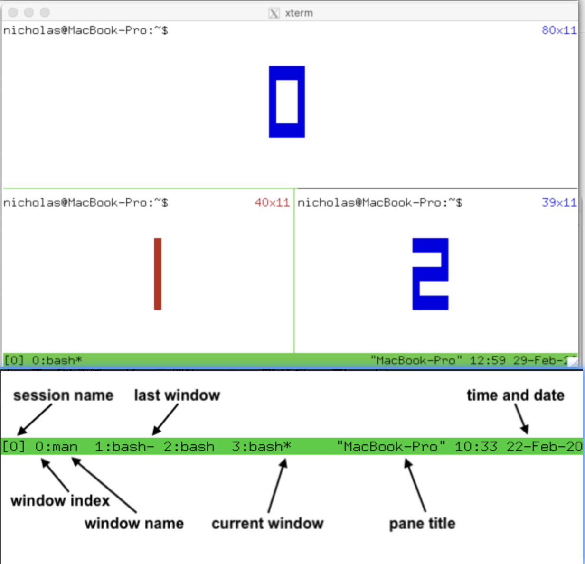

## tmux终端多路复用器使用文档

### tmux基本概念：
由`会话`、`窗口`、`窗格`, 一个会话由一个或多个窗口组成, 一个窗口由一个或多个窗格组成, 一个窗格就是一个终端[如下图]

- **会话**: `session-name` - 由会话名称作为唯一识别, 如果没有指定名称, 从0自动递增，用数字命名
- **窗口**: `window-id:window-name` - 由窗口名称或窗口id作为唯一识别, 如果没有指定名称, 窗口名称自动分配如bash, id从0自动递增
- **窗格**: `%0` - 由窗格下标作为唯一识别, 如果没有指定, 下标%0自动递增

### tmux命令使用技巧：
- `tmux ls`: 查看打开所有的会话
- `tmux list-windows`: 查看所有会话的详情
- `tmux attach -t <session-name>`: 进入指定会话

### tmux快捷键使用技巧
> 进入会话后使用, 支持通过鼠标点击，选择任何窗格和窗口

- ctrl+d: 关闭窗格 (和输入exit一样)
- ctrl+b d: 退出会话, 但不关闭窗格 (先按下ctrl+b, 在按下d)

### 其他小技巧

tmux new-session -d 'bash -i -c ./test2.sh' # 执行脚本完毕后自动退出

## 功能介绍
